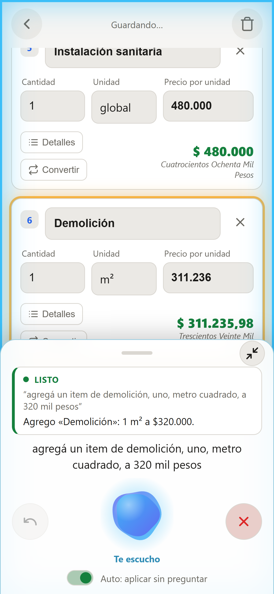
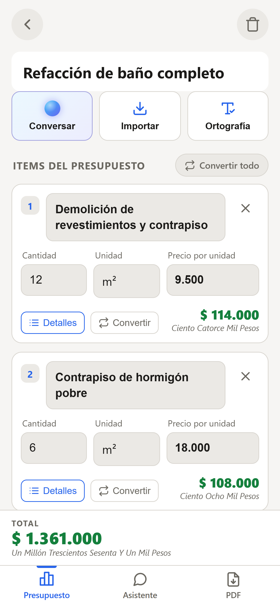
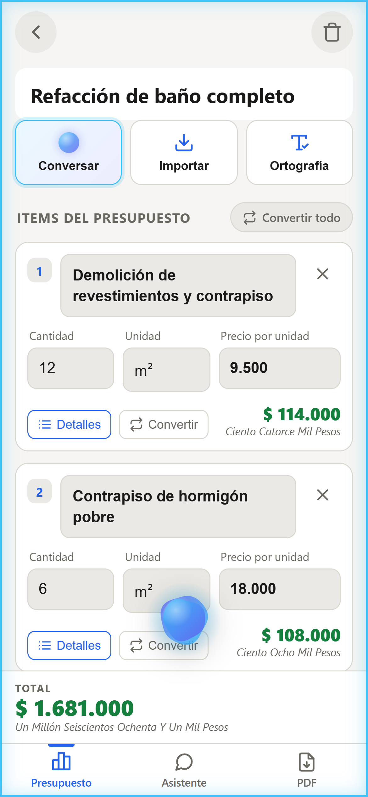
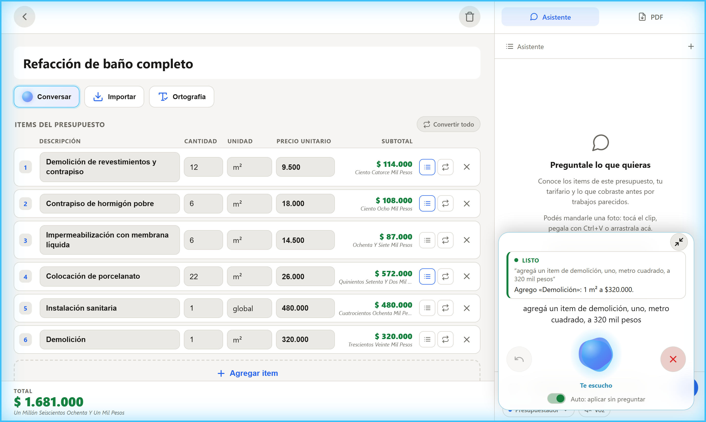
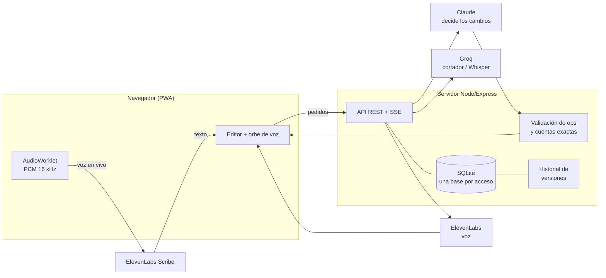

# Sistema de Presupuestos de Obra con asistente de voz

> **PWA full-stack para armar presupuestos de construcción desde el celular, hablándole a un asistente de IA.**
> Node.js · Express · SQLite · JavaScript vanilla · Claude · Groq · ElevenLabs · Docker

*English summary: a mobile-first PWA that lets a construction contractor build itemized quotes by voice. A real-time conversational assistant (speech-to-text → intent splitting → LLM → text-to-speech) edits the quote while you talk, with animated feedback, undo backed by a per-item version history, unit conversion done with exact server-side math, and PDF export. Built end-to-end — backend, frontend, AI pipeline, tests and deployment — by one developer.*



---

## Por qué existe

Mi papá es contratista de obra. Armaba los presupuestos a mano: anotaba en la obra, después pasaba todo a una planilla, sacaba cuentas de m² a m³ con la calculadora y armaba el PDF. Esta app reemplaza todo eso por **hablarle al teléfono**:

> *"Agregá un item de demolición, uno, metro cuadrado, a 320 mil pesos."*

El asistente lo entiende, muestra lo que va a hacer, lo carga con una animación y contesta en voz alta: *"Listo, agregué la demolición. ¿Con qué seguimos?"*. Se le puede dictar una planilla entera de corrido, corregir precios, poner el título y el cliente, deshacer cambios y exportar el PDF para el cliente o el municipio.

Está en producción, desplegada en un VPS propio con HTTPS.

## Lo que muestra este proyecto

| Área | Qué hay |
|---|---|
| **IA aplicada de verdad** | Pipeline de voz en tiempo real con **tres modelos** coordinados (voz a texto, un "cortador" rápido que separa pedidos, Claude que decide y una voz que responde). Ruteo de tareas entre proveedores según costo y riesgo. Streaming SSE. |
| **Criterio con la IA** | La IA **propone, el servidor valida y calcula**: nunca hace cuentas de plata ni escribe en la base directo. Defensas contra alucinaciones de Whisper, eco del parlante y precios inventados. |
| **Backend** | API REST con Express, SQLite con migraciones, autenticación con tokens HMAC propios, **una base de datos por acceso** (multi-tenant liviano), historial de versiones por item, CSP con hashes calculados al arrancar, rate limiting del login. |
| **Frontend sin frameworks** | JavaScript vanilla en módulos, sin build. Animaciones en canvas, Web Audio (AudioWorklet para capturar el micrófono a 16 kHz, compresor y limitador para la voz), PWA instalable con service worker. Mobile-first y vista de escritorio. |
| **Calidad** | Más de 180 pruebas automatizadas (`npm test`), decisiones documentadas en el propio código, bugs encontrados probando y corregidos con su prueba. |
| **Operación** | Docker, deploy por script a un VPS detrás de Nginx Proxy Manager con HTTPS, sin pisar la configuración del servidor. |

## Capturas

| Celular | Orbe flotante | Escritorio |
|---|---|---|
|  |  |  |

## Funcionalidades

**Modo conversación por voz** ([cómo funciona por dentro](docs/MODO-VOZ.md))
- Escucha en vivo y entiende cada pedido mientras se sigue hablando; se le puede leer una planilla de corrido.
- Muestra lo que pensó hacer antes de aplicarlo. Con **Auto** lo aplica solo; sin Auto espera un "sí".
- Carga items aunque falten datos (cantidad 1, la unidad lógica, el precio del tarifario o $0) y avisa qué quedó sin precio.
- Entiende "volvé al cambio anterior", "dejá el contrapiso con el precio que tenía" o "recuperá el item que borré", gracias a un **historial de versiones por item** guardado en la base.
- Orbe animado que cambia de color y movimiento según la fase (escucha, piensa, carga, habla); se achica a un orbe flotante y arrastrable.
- En el celular suena por el altavoz y más fuerte (ver [las limitaciones de audio del navegador y cómo se resolvieron](docs/MODO-VOZ.md#el-altavoz-del-celular)).

**Presupuesto**
- Items con cantidad, unidad de un catálogo y precio unitario; total en números y en letras.
- **Conversión de unidades exacta** (m² → m³ con el espesor, etc.) que preserva el total del item; la cuenta la hace el servidor, no la IA.
- Lectura de la **hoja de cambios del municipio** por foto: la compara contra el presupuesto y propone las conversiones.
- Importar items desde PDF, Excel, CSV o foto.
- **Tarifario propio** que la IA usa con prioridad sobre cualquier estimación.
- Exportación a **PDF** en dos formatos: cliente particular y municipal.

**Asistente de chat**
- Tres modos: asistente, investigador (busca precios actuales en internet con fuentes) y presupuestador (edita el presupuesto).
- Simula descuentos y redondeos sin aplicarlos, con las cuentas hechas por el servidor.

## Stack

| Capa | Tecnología |
|---|---|
| Backend | Node.js 20, Express 4, SQLite (`better-sqlite3`), Python para leer PDF/Excel y achicar fotos |
| Frontend | HTML, CSS y JavaScript vanilla (sin build), Web Audio API, Canvas, jsPDF, Service Worker |
| IA | **Claude** (decisiones, visión, chat), **Groq** (Whisper, cortador rápido, sugerencias), **ElevenLabs** (voz y escucha en vivo) |
| Infra | Docker, Nginx Proxy Manager, VPS (Hostinger), HTTPS |

## Arquitectura en una imagen



El detalle de cada pieza, las decisiones y sus contras están en [docs/ARQUITECTURA.md](docs/ARQUITECTURA.md).

## Probarlo en local

Requisitos: Node.js 20+ (o Docker) y al menos una clave de IA (Groq tiene capa gratuita).

```bash
git clone https://github.com/SoyMonardez/sistema-presupuestos.git
cd sistema-presupuestos
cp .env.example .env        # completar APP_PASSWORD, APP_SECRET y una API key
npm install
npm run dev                 # → http://localhost:3002
```

Con Docker:

```bash
docker compose -f docker-compose.local.yml up --build
```

Generar `APP_SECRET`:

```bash
node -e "console.log(require('crypto').randomBytes(32).toString('hex'))"
```

El micrófono necesita HTTPS o `localhost`. Para los datos que salen en el PDF, copiar `public/js/emisor.example.js` como `public/js/emisor.local.js`.

### Variables de entorno

| Variable | Para qué |
|---|---|
| `APP_PASSWORD` | Contraseña del acceso principal |
| `APP_PASSWORD_<NOMBRE>` | Accesos extra, cada uno con su propia base de datos |
| `APP_SECRET` | Firma de los tokens de sesión |
| `ANTHROPIC_API_KEY` | Claude: decisiones, chat, visión |
| `GROQ_API_KEY` | Groq: Whisper, cortador, sugerencias |
| `ELEVENLABS_API_KEY` | Voz del asistente y escucha en vivo (opcional: sin ella usa la voz del dispositivo y Whisper) |
| `AI_ROUTE_<TAREA>` | Mover una tarea de proveedor sin tocar código |

La lista completa con valores por defecto está en [`.env.example`](.env.example). Alcanza con **una** clave de IA para arrancar: si falta la del proveedor de una tarea, se usa el otro.

## Pruebas

```bash
npm test
```

Cubren lo que, si falla, corrompe un presupuesto sin que se note: validación de operaciones de la IA, conversiones, el historial de versiones, la lógica de la conversación (pendientes, deshacer, eco), los atajos de voz, el filtro de alucinaciones de Whisper, la lectura de montos en voz alta y la separación de datos entre accesos.

## Estructura

```
server/
  index.js            Express, seguridad (CSP, headers), rutas
  auth.js             tokens HMAC y accesos con base propia
  db.js               SQLite y migraciones
  routes/             budgets, ai, chat, voz, units, prices, import, settings
  ai/                 proveedores (Claude, Groq), ElevenLabs, ruteo por tarea
  lib/                validación de ops, conversiones, historial, cortador, vocabulario
public/
  js/                 módulos del frontend (estado, items, chat, voz, orbe, PDF…)
  css/app.css         estilos mobile-first + escritorio
docs/                 arquitectura, API, modo voz, deploy
```

## Documentación

- [Arquitectura y decisiones](docs/ARQUITECTURA.md)
- [Modo conversación por voz](docs/MODO-VOZ.md)
- [Referencia de la API](docs/API.md)
- [Deploy y operación](docs/DEPLOY.md)
- [Plan de la versión 2](docs/plan-v2.md)

## Autor

**Alejo Monardez** — desarrollador full-stack.
Diseñé y construí todo el proyecto: producto, backend, frontend, integración de IA, pruebas y despliegue.

- Portfolio: [alejomonardez.com](https://alejomonardez.com)
- GitHub: [@SoyMonardez](https://github.com/SoyMonardez)
