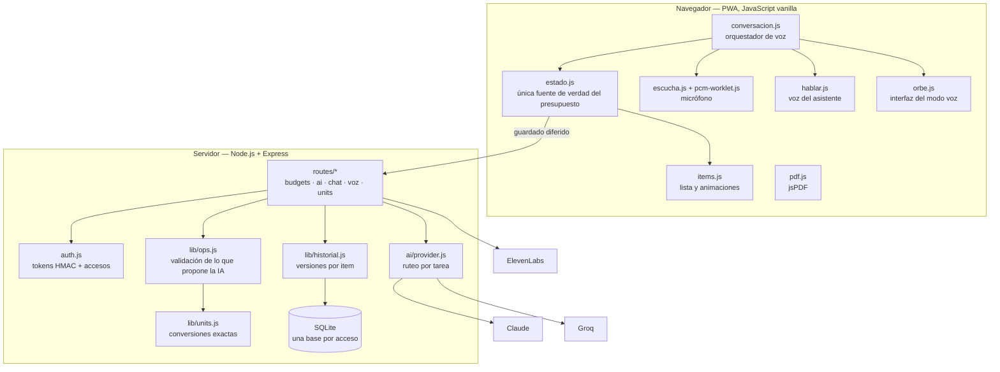
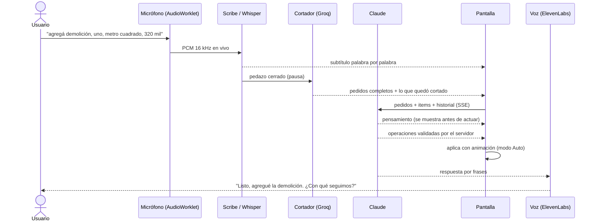

# Arquitectura y decisiones

Este documento explica cómo está armado el sistema y, sobre todo, **por qué** se decidió así. Cada decisión tiene su contra, y está escrita.

## Contexto y objetivos

- **Quién lo usa:** un contratista de obra, desde el celular, en la obra o en la camioneta. No es usuario técnico y muchas veces tiene las manos ocupadas.
- **Qué tiene que lograr:** pasar de "anotar en un papel y armar el presupuesto a la noche" a "dictarlo y que quede listo".
- **Qué no puede pasar:** que un número mal calculado o inventado llegue a un presupuesto que se le entrega a un cliente o a un municipio. Un error de plata se factura.

De ese último punto salen casi todas las decisiones de abajo.

## Vista general

## Decisiones clave

### 1. La IA propone, el servidor valida y calcula

Ningún modelo escribe en la base ni hace cuentas de plata. El flujo es siempre el mismo:

1. El modelo devuelve **operaciones** en JSON (`add`, `update`, `remove`, `convert`).
2. `lib/ops.js` las valida: descarta lo que no reconoce, normaliza unidades contra el catálogo, acota montos y textos.
3. Las cuentas (conversiones, descuentos, coeficiente de costo a venta) las hace el servidor con matemática exacta.
4. La pantalla las muestra para confirmar, o las aplica sola en modo Auto, siempre a través de `Estado`.

**Por qué:** un modelo de lenguaje multiplicando cantidades por precios en un solo paso se equivoca lo suficiente como para que importe. La red de seguridad es la validación, no el prompt.

**Contra:** más código para cada operación nueva. Se acepta: es código aburrido y probado.

### 2. Operaciones en JSON y no tool calling

Las rutas de IA piden un JSON con forma conocida en vez de usar herramientas del modelo.

**Por qué:** el patrón propone-valida-confirma ya funcionaba. Un bucle de herramientas agrega idas y vueltas de red por mensaje (latencia que en voz se escucha) y otra superficie de error, para llegar al mismo lugar.

**Contra:** hay que parsear JSON que a veces llega con adornos. `parseJsonFlexible` lo resuelve, y para el chat hay un modo laxo que conserva la respuesta aunque falten campos.

### 3. Ruteo de modelos por tarea

`ai/provider.js` elige el proveedor según lo que cuesta equivocarse:

| Tarea | Proveedor | Criterio |
|---|---|---|
| Sugerencias, ortografía, cortar lo dictado | Groq | Tiene que ser instantáneo; equivocarse es barato |
| Editar items, chat, leer fotos, decidir por voz | Claude | Equivocarse es caro: es plata frente a un cliente |
| Voz a texto (respaldo) | Groq Whisper | Rápido y casi gratis |
| Voz del asistente y escucha en vivo | ElevenLabs | Baja latencia y calidad de voz |

Cualquier tarea se mueve de proveedor con una variable `AI_ROUTE_<TAREA>`, y si falta la clave de uno se usa el otro con un aviso en el log. Alcanza con una sola clave para arrancar.

### 4. Frontend sin framework y sin build

Módulos IIFE en JavaScript plano, cargados en orden desde `index.html`.

**Por qué:** la app es una sola pantalla con estado chico, y se despliega copiando archivos. Sin build no hay nada que se rompa entre el código y lo que corre en el teléfono, y cualquiera puede leerlo.

**Cómo se mantiene ordenado:** el estado vive en un solo módulo (`estado.js`) y se toca solo a través de sus funciones. El array de items nunca se reemplaza: se vacía y se rellena, porque varios módulos lo guardan por referencia. Esa regla salió de un bug real con la conversión de unidades.

**Contra:** el orden de los `<script>` importa y hay que respetarlo. Está comentado en el HTML.

### 5. Una base de datos por acceso

Cada contraseña (`APP_PASSWORD`, `APP_PASSWORD_<NOMBRE>`) abre su propia base SQLite. El token lleva el nombre del acceso y un `AsyncLocalStorage` hace que cada consulta vaya a la base correcta.

**Por qué:** separar los datos de distintas personas sin agregar usuarios, roles ni una columna de dueño en cada tabla. Si una consulta se hace sin acceso activo, falla en vez de caer a la base principal: es preferible un error a mostrarle a alguien los datos de otro.

**Contra:** las migraciones corren por base. Las tablas nuevas (como el historial) se aseguran al usarse, en la base que esté activa.

### 6. Historial de versiones por item

Cada guardado de items deja una versión en `budget_history` con quién hizo el cambio (voz, chat, IA o a mano). Cada item tiene un `uid` estable para seguirlo aunque cambie de nombre, de lugar o se borre. Las ediciones manuales seguidas se juntan en una sola versión, y se guardan las últimas 300 por presupuesto.

A la IA se le pasa un resumen: los últimos cambios, del más reciente al más viejo, los valores anteriores de cada item y lo que se borró. Con eso entiende "volvé al precio anterior" o "recuperá la pintura".

**Un detalle que salió probando:** los cambios se llamaban `cambio`, `alta` y `baja`. Ante "deshacé el último cambio", el modelo buscaba el último de tipo `cambio` y se salteaba un borrado más reciente. Se renombraron a `modificado`, `agregado` y `borrado`, y cada paso dice explícitamente cuál es el más reciente.

### 7. Guardado diferido con cola

La pantalla guarda 900 ms después del último cambio y los guardados van de a uno en cola. Cada guardado congela el id y los items **antes** del primer `await`.

**Por qué:** el guardado reemplaza la lista completa. Si dos guardados se solapan y llegan fuera de orden, el viejo pisa al nuevo y se pierde una edición en silencio. Y si se cambia de presupuesto entre dos `await`, el segundo escribiría en el que no es.

## Seguridad

- **Las claves de las APIs nunca salen del servidor.** Para la escucha en vivo, el navegador recibe un token de ElevenLabs de un solo uso que vence a los 15 minutos.
- **Autenticación propia:** tokens firmados con HMAC-SHA256, comparación en tiempo constante, vencimiento.
- **Rate limiting del login** por IP (10 intentos cada 15 minutos), con `trust proxy` en 1 salto para que no se pueda saltear inventando `X-Forwarded-For`.
- **Content-Security-Policy** que se calcula al arrancar, con el hash SHA-256 de cada script inline. Ya pasó que el nombre de un item importado de un Excel terminara ejecutándose; con la CSP eso queda en un texto raro.
- **Datos personales fuera del repositorio:** los datos del emisor del PDF y los del servidor viven en archivos locales en `.gitignore`.

## Flujo de un pedido por voz

El detalle está en [MODO-VOZ.md](MODO-VOZ.md).

## Pruebas

Las pruebas son scripts de Node sin framework, una por área, y corren con `npm test`. Prueban funciones puras, separadas de la red, los temporizadores y el micrófono a propósito: probar la detección de silencio en un navegador da falsos negativos porque Chrome estrangula los temporizadores de las pestañas en segundo plano.

Cuando un bug aparece probando, queda una prueba con el caso. Algunos ejemplos:
- un pedido que el cortador daba por completo cuando terminaba en "a" ("…18 metros cuadrados a");
- el filtro de eco que se comía "ahora el contrapiso a 21 mil" porque compartía palabras con la respuesta anterior;
- Whisper devolviendo "¡Gracias!" sobre puro ruido.
